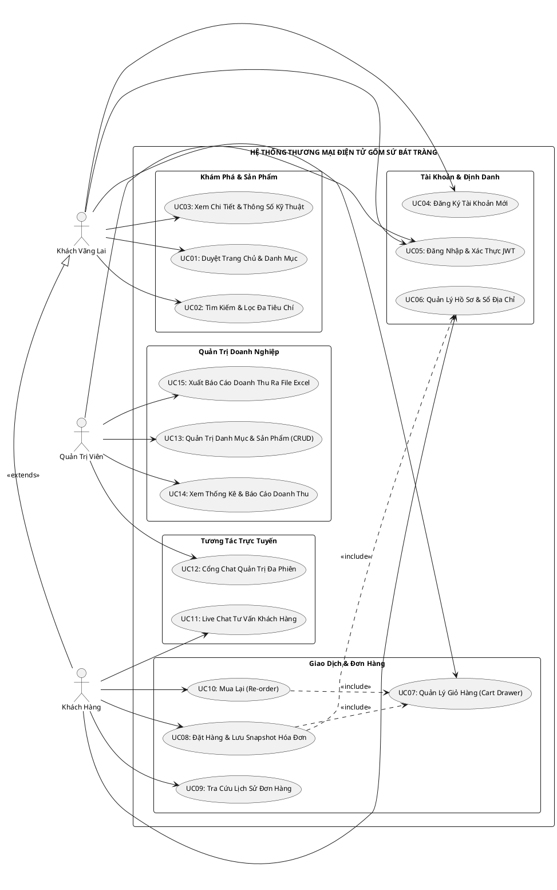

# BỘ GIÁO DỤC VÀ ĐÀO TẠO — TRƯỜNG ĐẠI HỌC KỸ THUẬT CÔNG NGHỆ
# KHOA CÔNG NGHỆ THÔNG TIN — BỘ MÔN LẬP TRÌNH TRỰC QUAN

---

# BÁO CÁO BÀI TẬP LỚN MÔN HỌC

### **ĐỀ TÀI:**
## **XÂY DỰNG HỆ THỐNG THƯƠNG MẠI ĐIỆN TỬ & QUẢN TRỊ DOANH NGHIỆP GỐM SỨ BÁT TRÀNG**

### **CHUYÊN ĐỀ:**
### **NỀN TẢNG E-COMMERCE B2C VÀ QUẢN TRỊ ĐA CHIỀU — DI SẢN & NGHỆ THUẬT ĐẤT VIỆT**

---

**Sinh viên thực hiện:** Nhóm 5 — Lập trình trực quan  
**Giảng viên hướng dẫn:** Bộ môn Lập trình trực quan & Công nghệ phần mềm  
**Năm học:** 2025 – 2026  

---

## LỜI MỞ ĐẦU

Làng nghề gốm sứ Bát Tràng (Gia Lâm, Hà Nội) là biểu tượng ngàn năm văn hiến, kết tinh tinh hoa lao động, mỹ thuật và kỹ nghệ chế tác đất sét nung của dân tộc Việt Nam. Trải qua các triều đại Lý, Trần, Lê, Nguyễn đến thời kỳ hội nhập 4.0, các nghệ nhân Bát Tràng đã sáng tạo nên những dòng men danh tiếng như men lam cổ, men rạn tam thái, men hoàng tộc, men hỏa biến ngọc bích cùng kỹ thuật vuốt tay điêu luyện.

Tuy nhiên, trong bối cảnh thương mại số phát triển vũ bão, phương thức kinh doanh truyền thống của các làng nghề thủ công đang đối mặt với nhiều rào cản:
1. **Rào cản địa lý & tiếp cận khách hàng:** Hoạt động thương mại phụ thuộc nặng nề vào các cửa hàng thực tế, khách du lịch vãng lai hoặc kênh phân phối trung gian khiến biên lợi nhuận bị bào mòn và thương hiệu khó vươn xa.
2. **Đặc thù phức tạp của sản phẩm thủ công mỹ nghệ:** Mỗi sản phẩm gốm sứ đều có tính cá nhân hóa cao về dòng men, kiểu dáng, kích thước chuẩn phong thủy và nhiệt độ nung. Khách hàng trực tuyến rất khó hình dung đầy đủ nếu thiếu dữ liệu chi tiết, hình ảnh sắc nét và tư vấn kỹ thuật trực quan.
3. **Thách thức quản trị đơn hàng & bất biến dữ liệu:** Trong thương mại điện tử, giá sản phẩm và địa chỉ nhận hàng có thể thay đổi liên tục theo thời gian. Nếu không có kiến trúc cơ sở dữ liệu chuyên biệt (Snapshot Pattern), hệ thống kế toán - vận chuyển sẽ bị sai lệch nghiêm trọng khi tra cứu lại lịch sử hóa đơn cũ.
4. **Độ trễ trong tương tác & hỗ trợ khách hàng:** Mặt hàng gốm sứ tâm linh, phong thủy đòi hỏi sự tư vấn tức thời và chuyên sâu. Việc thiếu kênh chat trực tuyến thời gian thực khiến tỷ lệ bỏ rơi giỏ hàng gia tăng.

Nhận thức rõ những bài toán cấp thiết đó, nhóm nghiên cứu đã lựa chọn và triển khai đề tài: **"Xây dựng Hệ thống Thương Mại Điện Tử & Quản Trị Doanh Nghiệp Gốm Sứ Bát Tràng"**. Hệ thống được xây dựng trên nền tảng kiến trúc hiện đại, tách biệt hoàn toàn giữa Backend (**ASP.NET Core 8 Web API, Entity Framework Core 8, Microsoft SQL Server 2022**) và Frontend (**React 18 SPA, Vite, Tailwind CSS, SignalR WebSocket**), hướng tới việc chuyển đổi số toàn diện cho doanh nghiệp làng nghề, tôn vinh giá trị văn hóa truyền thống và tối ưu hóa trải nghiệm người dùng.

---

## MỤC LỤC

- **LỜI MỞ ĐẦU**
- **DANH MỤC TỪ VIẾT TẮT**
- **DANH MỤC BẢNG BIỂU & HÌNH ẢNH**
- **CHƯƠNG 1: TỔNG QUAN ĐỀ TÀI VÀ PHÂN TÍCH YÊU CẦU HỆ THỐNG**
  - 1.1. Bối cảnh đề tài và khảo sát thực trạng
  - 1.2. Mô tả 6 nghiệp vụ cốt lõi của hệ thống
  - 1.3. Phân tích yêu cầu chức năng theo 3 lớp tác nhân (Actors)
  - 1.4. Yêu cầu phi chức năng (Non-Functional Requirements)
- **CHƯƠNG 2: PHÂN TÍCH VÀ THIẾT KẾ HỆ THỐNG**
  - 2.1. Thiết kế biểu đồ Use-Case và bảng đặc tả Use-Case
  - 2.2. Thiết kế Cơ sở dữ liệu và Cơ chế Snapshot bất biến
  - 2.3. Từ điển dữ liệu chi tiết (Data Dictionary)
  - 2.4. Thiết kế Kiến trúc hệ thống, Sitemap & Luồng người dùng (User Flow)
- **CHƯƠNG 3: HIỆN THỰC HÓA VÀ XÂY DỰNG HỆ THỐNG**
  - 3.1. Cấu trúc mã nguồn Backend (.NET 8 Web API)
  - 3.2. Cấu trúc mã nguồn Frontend (React 18 Single Page Application)
  - 3.3. Tích hợp giao tiếp thời gian thực với SignalR Hub
  - 3.4. Hiện thực hóa giao diện và minh chứng kết quả thực tế qua 10 màn hình
- **CHƯƠNG 4: KIỂM THỬ VÀ ĐÁNH GIÁ CHẤT LƯỢNG HỆ THỐNG**
  - 4.1. Mục tiêu và phương pháp luận kiểm thử
  - 4.2. Chi tiết 10 Kịch bản kiểm thử tích hợp (TC01 - TC10) & Quá trình khắc phục lỗi
  - 4.3. Bảng kiểm thử toàn diện 30/30 API Endpoints
- **CHƯƠNG 5: KẾT LUẬN VÀ HƯỚNG PHÁT TRIỂN**
  - 5.1. Kết quả đạt được của dự án
  - 5.2. 4 Bài học kinh nghiệm thực tế sâu sắc
  - 5.3. Định hướng nghiên cứu và nâng cấp hệ thống
- **TÀI LIỆU THAM KHẢO**

---

## DANH MỤC TỪ VIẾT TẮT

| Viết tắt | Thuật ngữ đầy đủ | Ý nghĩa kỹ thuật |
| :--- | :--- | :--- |
| **API** | Application Programming Interface | Giao diện lập trình ứng dụng |
| **B2C** | Business to Consumer | Mô hình thương mại từ doanh nghiệp đến người tiêu dùng |
| **CRUD** | Create - Read - Update - Delete | 4 thao tác quản trị dữ liệu cơ bản |
| **DI** | Dependency Injection | Kỹ thuật tiêm phụ thuộc trong thiết kế phần mềm |
| **DTO** | Data Transfer Object | Đối tượng vận chuyển dữ liệu giữa các tầng kiến trúc |
| **EF Core** | Entity Framework Core | Thư viện ORM (Object-Relational Mapping) của .NET |
| **ERD** | Entity Relationship Diagram | Biểu đồ thực thể - liên kết cơ sở dữ liệu |
| **JWT** | JSON Web Token | Chuẩn mã hóa token xác thực an toàn |
| **ORM** | Object-Relational Mapping | Ánh xạ cấu trúc bảng CSDL thành các lớp đối tượng |
| **REST** | Representational State Transfer | Phong cách kiến trúc dịch vụ mạng không trạng thái |
| **SPA** | Single Page Application | Ứng dụng web đơn trang mượt mà không tải lại |
| **UI/UX** | User Interface / User Experience | Giao diện người dùng / Trải nghiệm người dùng |
| **WS** | WebSocket | Giao thức truyền thông hai chiều thời gian thực |

---

## DANH MỤC BẢNG BIỂU & HÌNH ẢNH

### Danh mục Bảng
- **Bảng 1.1:** Bảng phân tích 3 lớp tác nhân và ma trận phân quyền hệ thống
- **Bảng 2.1:** Bảng đặc tả các Use Case chính trong hệ thống
- **Bảng 2.2:** Từ điển dữ liệu chi tiết các thực thể cốt lõi trong CSDL SQL Server
- **Bảng 4.1:** Bảng tổng hợp kết quả thực thi 10 Test Cases tích hợp (TC01 - TC10)
- **Bảng 4.2:** Bảng kiểm thử chi tiết 30/30 API Endpoints của hệ thống

### Danh mục Hình ảnh
- **Hình 2.1:** Biểu đồ Use Case tổng quan của Hệ thống Gốm Sứ Bát Tràng
- **Hình 2.2:** Sơ đồ liên kết thực thể (ERD) 22 bảng CSDL SQL Server 2022
- **Hình 2.3:** Sơ đồ luồng dữ liệu kiến trúc phân tầng Client - Server
- **Hình 2.4:** Sơ đồ cấu trúc phân cấp chức năng hệ thống (Sitemap Architecture)
- **Hình 2.5:** Bản vẽ Wireframe tổng thể 4 màn hình cốt lõi (Low-Fidelity B&W Overview)
- **Hình 2.6:** Bản vẽ Wireframe chi tiết Màn hình Trang Chủ (Home Page Wireframe)
- **Hình 2.7:** Bản vẽ Wireframe chi tiết Màn hình Chi Tiết Sản Phẩm & Đặt Hàng (Product Detail Wireframe)
- **Hình 2.8:** Bản vẽ Wireframe Giỏ Hàng Slide-over & Thủ Tục Thanh Toán Snapshot (Cart & Checkout Wireframe)
- **Hình 2.9:** Bản vẽ Wireframe Cổng Quản Trị Hệ Thống (Admin Portal Dashboard Wireframe)
- **Hình 3.1:** Giao diện Trang chủ Bát Tràng — Hero Banner & Bộ sưu tập men gốm di sản
- **Hình 3.2:** Danh mục sản phẩm & Bộ lọc đa tiêu chí (Dòng men, Kích thước, Giá)
- **Hình 3.3:** Thiết kế Thẻ sản phẩm (Product Card) tích hợp nhãn Men và thông số kỹ thuật
- **Hình 3.4:** Modal Chi tiết sản phẩm & Thông tin nghệ nhân chế tác thủ công
- **Hình 3.5:** Giỏ hàng dạng trượt (Cart Drawer) & Tương tác điều chỉnh số lượng tức thì
- **Hình 3.6:** Trạng thái giỏ hàng thu gọn & Huy hiệu đếm số lượng thời gian thực
- **Hình 3.7:** Chế độ xem danh sách sản phẩm cuộn mượt (Scroll View) tối ưu hiệu năng
- **Hình 3.8:** Lưới hiển thị các mặt hàng gốm sứ độc bản và giá niêm yết
- **Hình 3.9:** Tương tác chuyển đổi mượt mà giữa xem danh mục và mở chi tiết
- **Hình 3.10:** Trải nghiệm hiển thị đa thiết bị (Responsive Design) trên Mobile và Desktop

---

# CHƯƠNG 1: TỔNG QUAN ĐỀ TÀI VÀ PHÂN TÍCH YÊU CẦU HỆ THỐNG

## 1.1. Bối cảnh đề tài và khảo sát thực trạng
Làng gốm Bát Tràng có lịch sử hơn 700 năm, nổi danh khắp trong và ngoài nước với những sản phẩm gốm đất sét trắng, men rạn độc đáo và nét vẽ thanh thoát. Tuy nhiên, chuyển đổi số tại các cơ sở kinh doanh gốm sứ hiện nay còn manh mún, chủ yếu phụ thuộc vào mạng xã hội hoặc các sàn thương mại điện tử chung chung. Khảo sát thực tế các chủ lò gốm và khách hàng mua đồ thủ công mỹ nghệ cho thấy:
- **Khách hàng** gặp khó khăn trong việc chọn lựa sản phẩm đúng nhu cầu phong thủy, kích thước bàn thờ/phòng khách, hoặc xác định chất men do thiếu bộ lọc đặc thù.
- **Doanh nghiệp** gặp trở ngại trong việc đồng bộ giỏ hàng, xác thực đơn hàng, quản lý kho nhiều biến thể (men lam, men rạn, men ngọc), xuất hóa đơn và tư vấn khách hàng tức thời.

## 1.2. Mô tả 6 nghiệp vụ cốt lõi của hệ thống
Hệ thống được thiết kế xoay quanh 6 trụ cột nghiệp vụ then chốt:
1. **Nghiệp vụ Quản lý Danh mục & Sản phẩm Gốm sứ:** Chuẩn hóa dữ liệu theo đặc thù làng nghề: Dòng men (Glaze), Kiểu dáng, Kích thước, Giá bán, Tình trạng tồn kho, Nghệ nhân chế tác.
2. **Nghiệp vụ Khám phá & Tìm kiếm Thông minh:** Cung cấp công cụ tìm kiếm toàn văn (Full-Text Search) kết hợp bộ lọc đa tiêu chí (Multi-criteria Filter) cho phép lọc cùng lúc theo khoảng giá, dòng men và phân loại hàng mà không gây giật lag giao diện.
3. **Nghiệp vụ Mua hàng & Quản lý Giỏ hàng (Cart Drawer):** Trải nghiệm mua sắm không làm gián đoạn việc duyệt web nhờ Cart Drawer trượt mượt mà từ cạnh phải, tự động tính toán tổng tiền, lưu trữ giỏ hàng an toàn qua LocalStorage và đồng bộ cơ sở dữ liệu.
4. **Nghiệp vụ Sổ Địa Chỉ & Đặt Hàng An Toàn:** Khách hàng có thể lưu trữ nhiều địa chỉ giao hàng và chỉ định một địa chỉ mặc định. Khi đặt hàng, hệ thống chụp lại (Snapshot) thông tin địa chỉ và đơn giá tại thời điểm giao dịch, triệt tiêu nguy cơ sai lệch kế toán khi dữ liệu gốc thay đổi.
5. **Nghiệp vụ Tư Vấn Trực Tuyến Thời Gian Thực (Live Chat):** Tích hợp WebSocket thông qua ASP.NET Core SignalR, cho phép khách hàng trao đổi trực tiếp với quản trị viên/tư vấn viên về thông số kỹ thuật, hình ảnh thật của sản phẩm ngay tại xưởng.
6. **Nghiệp vụ Quản Trị & Phân Tích Doanh Thu:** Cung cấp bảng điều khiển (Dashboard) KPI trực quan cho người quản lý, hỗ trợ xuất báo cáo doanh số, đơn hàng và sản phẩm bán chạy ra file Excel (.xlsx) chuẩn nghiệp vụ kế toán.

## 1.3. Phân tích yêu cầu chức năng theo 3 lớp tác nhân (Actors)

Hệ thống phân định rành mạch 3 nhóm tác nhân tham gia vào quy trình nghiệp vụ:

### a) Khách vãng lai (Guest / Chưa đăng nhập):
- Xem trang chủ, duyệt bộ sưu tập gốm sứ mới nhất, sản phẩm nổi bật và bài viết văn hóa làng nghề.
- Tìm kiếm sản phẩm theo từ khóa và áp dụng bộ lọc đa tiêu chí.
- Xem trang chi tiết sản phẩm: Tên hàng, thông số kích thước, hình ảnh độ phân giải cao, giá niêm yết và hướng dẫn bảo quản.
- Đăng ký tài khoản khách hàng mới và Đăng nhập hệ thống.
- Thêm sản phẩm vào giỏ hàng tạm thời. Hệ thống kiểm soát bảo mật: tự động yêu cầu đăng nhập khi khách hàng bấm nút "Tiến hành Đặt hàng" hoặc mở khung Live Chat.

### b) Khách hàng đã đăng ký (Registered Customer):
- Kế thừa toàn bộ quyền hạn của Khách vãng lai.
- Quản lý hồ sơ cá nhân: Họ tên, số điện thoại, đổi mật khẩu bảo mật.
- Quản lý Sổ Địa Chỉ Nhận Hàng (Address Book): Thêm mới, cập nhật, xóa và đánh dấu địa chỉ mặc định.
- Đặt hàng & Mua sắm an toàn: Chọn nhanh địa chỉ nhận hàng, chọn phương thức thanh toán (COD / Chuyển khoản), hệ thống tự động sinh mã hóa đơn duy nhất (Format: `HD_YYYYMMDD_HHMMSS_RANDOM`).
- Tra cứu Tab "Đơn Hàng Đã Đặt" trực tiếp trên Cart Drawer: Xem lại lịch sử các đơn hàng đã đặt, theo dõi trạng thái xử lý (Chờ duyệt, Đang giao, Đã giao, Đã hủy).
- Nghiệp vụ Mua lại (Re-order): Cho phép khách hàng nạp lại toàn bộ danh mục sản phẩm từ một đơn hàng cũ vào giỏ hàng hiện tại chỉ với một thao tác bấm chuột.
- Trò chuyện trực tuyến (Live Chat): Mở khung chat với nhân viên hỗ trợ để được tư vấn sản phẩm.

### c) Quản trị viên (Admin):
- Đăng nhập hệ thống bằng tài khoản quản trị có vai trò (Role) `Admin`.
- Quản lý Danh mục & Sản phẩm (CRUD): Thêm mới mẫu gốm, sửa thông tin kỹ thuật, cập nhật đơn giá, upload ảnh sản phẩm, quản lý số lượng tồn kho.
- Cơ chế Tự Động Xóa Cache (Cache Invalidation): Khi quản trị viên cập nhật hoặc xóa sản phẩm, hệ thống lập tức làm mới vùng nhớ tạm (In-Memory Cache), đảm bảo người dùng cuối luôn nhìn thấy dữ liệu mới nhất.
- Cổng Tiếp Nhận Tư Vấn Khách Hàng (Admin Chat Portal): Tiếp nhận tin nhắn đồng thời từ nhiều khách hàng, chuyển đổi giữa các phiên chat theo thời gian thực.
- Báo Cáo Thống Kê & Phân Tích Kinh Doanh: Bảng biểu thống kê tổng doanh thu, số lượng đơn hàng, tỷ lệ chuyển đổi và giá trị đơn trung bình (AOV).
- Xuất Dữ Liệu Báo Cáo Excel Đa Sheet: Kết xuất file Excel (.xlsx) chuẩn kế toán gồm 3 trang tính (Sheets): "Tổng Hợp Doanh Thu", "Chi Tiết Đơn Hàng" và "Tồn Kho Sản Phẩm".

### Bảng 1.1: Ma trận Phân quyền & Chức năng Hệ thống

| Nhóm chức năng | Nghiệp vụ cụ thể | Khách vãng lai | Khách hàng đăng ký | Quản trị viên |
| :--- | :--- | :---: | :---: | :---: |
| **Duyệt & Tìm kiếm** | Xem trang chủ, danh mục sản phẩm | V | V | V |
| | Tìm kiếm toàn văn & Lọc đa tiêu chí | V | V | V |
| | Xem chi tiết sản phẩm & thông số men | V | V | V |
| **Giỏ hàng & Đơn hàng** | Thêm hàng vào giỏ tạm thời | V | V | - |
| | Quản lý Sổ địa chỉ (Address Book) | X | V | - |
| | Đặt hàng & Nhận mã hóa đơn an toàn | X | V | - |
| | Xem lịch sử đơn hàng & Tính năng Mua lại | X | V | - |
| **Tương tác trực tuyến** | Chat tư vấn thời gian thực với nhân viên | X | V | - |
| | Cổng chat quản trị đa khách hàng | X | X | V |
| **Quản trị hệ thống** | Thêm / Sửa / Xóa sản phẩm & danh mục | X | X | V |
| | Cơ chế tự động giải phóng Cache (Invalidation) | X | X | V |
| | Thống kê Dashboard & Xuất Excel 3 Sheets | X | X | V |

---

# CHƯƠNG 2: PHÂN TÍCH VÀ THIẾT KẾ HỆ THỐNG

## 2.1. Thiết kế biểu đồ Use-Case và bảng đặc tả Use-Case

Hệ thống được mô hình hóa hướng đối tượng bằng công cụ biểu diễn Use-Case chuẩn mực:


*Hình 2.1: Biểu đồ Use Case tổng quan của Hệ thống Gốm Sứ Bát Tràng*

### Bảng 2.1: Đặc tả các Use Case cốt lõi

| Mã Use Case | Tên Use Case | Tác nhân chính | Tiền điều kiện | Mô tả luồng sự kiện chính |
| :--- | :--- | :--- | :--- | :--- |
| **UC02** | Tìm kiếm & Lọc đa tiêu chí | Guest, Customer | Truy cập hệ thống | Khách nhập từ khóa hoặc chọn Men/Giá/Loại -> Hệ thống trả về danh sách phù hợp theo thời gian thực. |
| **UC06** | Quản lý Sổ địa chỉ | Customer | Đã đăng nhập JWT | Khách thêm mới/sửa/xóa địa chỉ, gắn cờ IsDefault để hệ thống ưu tiên điền khi thanh toán. |
| **UC08** | Đặt hàng & Lưu Snapshot | Customer | Có hàng trong giỏ | Khách xác nhận địa chỉ và phương thức thanh toán -> Hệ thống sinh mã hóa đơn, ghi đè Snapshot địa chỉ và đơn giá vào bảng `HoaDon` và `ChiTietHoaDon`. |
| **UC10** | Mua lại (Re-order) | Customer | Đã từng có đơn hàng | Khách bấm "Mua lại" tại đơn hàng cũ -> Hệ thống lặp qua danh sách chi tiết đơn cũ, kiểm tra tồn kho và nạp vào giỏ hàng hiện tại. |
| **UC11** | Live Chat tư vấn | Customer | Đã đăng nhập | Khách mở widget chat -> Kết nối SignalR Hub -> Gửi/nhận tin nhắn hai chiều tức thì với Admin. |
| **UC15** | Xuất báo cáo Excel | Admin | Đã đăng nhập quyền Admin | Admin chọn mốc thời gian -> Bấm xuất Excel -> Backend dùng ClosedXML kết xuất file `.xlsx` gồm 3 sheet chuyên nghiệp. |

---

## 2.2. Thiết kế Cơ sở dữ liệu và Cơ chế Snapshot bất biến

Hệ thống sử dụng cơ sở dữ liệu quan hệ **Microsoft SQL Server 2022** gồm 22 bảng thực thể liên kết chặt chẽ.

```
                    ┌──────────────┐       1..N       ┌──────────────┐
                    │  KhachHang   │──────────────────│ SoDiaChiNhan │
                    └──────────────┘                  └──────────────┘
                           │ 1                               │
                           │                                 │ (Lấy địa chỉ
                           │ 1..N                            │  làm mẫu)
                           ▼                                 ▼
                    ┌──────────────┐       1..N       ┌──────────────┐
                    │    HoaDon    │──────────────────│ChiTietHoaDon │
                    │ (LưuSnapshot)│                  │(LưuSnapshot) │
                    └──────────────┘                  └──────────────┘
                                                             │ N..1
                                                             ▼
                    ┌──────────────┐       1..N       ┌──────────────┐
                    │   DanhMuc    │──────────────────│   SanPham    │
                    └──────────────┘                  └──────────────┘
```
*Hình 2.2: Sơ đồ liên kết thực thể (ERD) quan trọng trong CSDL SQL Server*

### Cơ chế Snapshot Bất Biến (Immutable Transaction Snapshot)
Một trong những lỗi nghiêm trọng nhất trong các hệ thống thương mại điện tử là **phụ thuộc động vào khóa ngoại khi tra cứu hóa đơn cũ**:
- Nếu giá sản phẩm tại bảng `SanPham` tăng từ `500,000 VNĐ` lên `700,000 VNĐ`, hoặc tên sản phẩm bị sửa, việc hiển thị hóa đơn cũ bằng cách JOIN với bảng `SanPham` sẽ làm sai lệch hoàn toàn doanh thu quá khứ.
- Nếu khách hàng sửa địa chỉ nhận hàng trong `SoDiaChiNhan`, các đơn hàng cũ đang trên đường giao hoặc đã hoàn thành sẽ bị chuyển sai địa chỉ.

**Giải pháp kỹ thuật của Hệ thống Gốm Sứ Bát Tràng:**
1. **Tại bảng `HoaDon`:** Thiết kế các trường dữ liệu Snapshot độc lập: `NguoiNhan_Snapshot`, `SoDienThoai_Snapshot`, `DiaChiChiTiet_Snapshot`. Khi khách đặt hàng, hệ thống sao chép giá trị từ `SoDiaChiNhan` sang các trường này.
2. **Tại bảng `ChiTietHoaDon`:** Lưu trữ trực tiếp `TenSanPham_Snapshot` và `DonGiaMua_Snapshot`. Khi truy vấn lịch sử đơn hàng, hệ thống đọc trực tiếp từ Snapshot mà không bị ảnh hưởng bởi các thao tác cập nhật bảng sản phẩm trong tương lai.

---

## 2.3. Từ điển dữ liệu chi tiết (Data Dictionary)

### Bảng 2.2: Đặc tả cấu trúc các bảng CSDL cốt lõi

#### 1. Bảng `SanPham` (Quản lý mặt hàng gốm sứ)
| Cột dữ liệu | Kiểu dữ liệu | Ràng buộc | Diễn giải nghiệp vụ |
| :--- | :--- | :--- | :--- |
| `MaSanPham` | `INT` | PK, Identity(1,1) | Mã định danh duy nhất của sản phẩm gốm |
| `MaDanhMuc` | `INT` | FK -> DanhMuc | Mã danh mục phân loại (Bát đĩa, Lọ hoa, Ấm chén) |
| `TenSanPham` | `NVARCHAR(200)` | NOT NULL | Tên sản phẩm gốm sứ mỹ nghệ |
| `DongMen` | `NVARCHAR(100)` | NULL | Dòng men chế tác (Men lam, Men rạn, Men hỏa biến) |
| `KichThuoc` | `NVARCHAR(100)` | NULL | Kích thước sản phẩm (Chiều cao, đường kính) |
| `GiaBan` | `DECIMAL(18,2)` | NOT NULL, >= 0 | Đơn giá niêm yết hiện hành |
| `SoLuongTon` | `INT` | NOT NULL, >= 0 | Số lượng sản phẩm có sẵn trong kho |
| `HinhAnh` | `NVARCHAR(500)` | NULL | Đường dẫn ảnh đại diện sản phẩm |
| `MoTa` | `NVARCHAR(MAX)` | NULL | Mô tả chi tiết kỹ thuật nung và ý nghĩa văn hóa |
| `NgayTao` | `DATETIME2` | Default: GETDATE() | Thời điểm tạo sản phẩm trong hệ thống |

#### 2. Bảng `HoaDon` (Quản lý đơn đặt hàng)
| Cột dữ liệu | Kiểu dữ liệu | Ràng buộc | Diễn giải nghiệp vụ |
| :--- | :--- | :--- | :--- |
| `MaHoaDon` | `INT` | PK, Identity(1,1) | Khóa chính tự tăng |
| `SoHoaDon` | `VARCHAR(50)` | UNIQUE, NOT NULL | Mã số hóa đơn hiển thị (VD: HD_20261019_001) |
| `MaKhachHang` | `INT` | FK -> KhachHang | Mã khách hàng thực hiện giao dịch |
| `NgayDat` | `DATETIME2` | Default: GETDATE() | Thời điểm phát sinh giao dịch đặt hàng |
| `TongTien` | `DECIMAL(18,2)` | NOT NULL, >= 0 | Tổng giá trị thanh toán của hóa đơn |
| `TrangThai` | `NVARCHAR(50)` | NOT NULL | Trạng thái: Chờ duyệt / Đang giao / Hoàn thành |
| `NguoiNhan_Snapshot` | `NVARCHAR(150)`| NOT NULL | Họ tên người nhận tại thời điểm đặt hàng |
| `SoDienThoai_Snapshot`| `VARCHAR(20)` | NOT NULL | Số điện thoại nhận hàng tại thời điểm đặt |
| `DiaChiGiao_Snapshot` | `NVARCHAR(500)`| NOT NULL | Địa chỉ giao hàng đầy đủ tại thời điểm đặt |

#### 3. Bảng `ChiTietHoaDon` (Quản lý từng dòng mặt hàng trong hóa đơn)
| Cột dữ liệu | Kiểu dữ liệu | Ràng buộc | Diễn giải nghiệp vụ |
| :--- | :--- | :--- | :--- |
| `MaChiTiet` | `INT` | PK, Identity(1,1) | Khóa chính tự tăng |
| `MaHoaDon` | `INT` | FK -> HoaDon | Tham chiếu đến hóa đơn cha |
| `MaSanPham` | `INT` | FK -> SanPham | Mã sản phẩm gốc (dùng cho thống kê) |
| `TenSP_Snapshot` | `NVARCHAR(200)` | NOT NULL | Tên sản phẩm lưu trữ bất biến |
| `DonGia_Snapshot` | `DECIMAL(18,2)` | NOT NULL | Đơn giá sản phẩm tại thời điểm mua |
| `SoLuong` | `INT` | NOT NULL, > 0 | Số lượng sản phẩm khách đặt mua |
| `ThanhTien` | `DECIMAL(18,2)` | NOT NULL | Thành tiền = DonGia_Snapshot * SoLuong |

---

```
┌────────────────────────────────────────────────────────┐
│             NGƯỜI DÙNG CUỐI (WEB BROWSER)              │
│       React 18 SPA + Vite + Tailwind CSS + Lucide      │
└───────────────────────────┬────────────────────────────┘
                            │ HTTPS / RESTful API (JSON)
                            │ WSS / WebSocket (SignalR)
┌───────────────────────────▼────────────────────────────┐
│         TẦNG BACKEND (.NET 8 WEB API SERVER)           │
│  - Controllers: SanPham, HoaDon, KhachHang, Chat       │
│  - Middleware: ExceptionHandler, JWT Auth, CORS        │
│  - Services: ProductService, OrderService, ExportExcel │
│  - Hubs: BatTrangChatHub (Realtime Message Push)       │
└───────────────────────────┬────────────────────────────┘
                            │ Entity Framework Core 8 (ORM)
                            │ Connection Pooling & Transactions
┌───────────────────────────▼────────────────────────────┐
│      TẦNG DỮ LIỆU (MICROSOFT SQL SERVER 2022)          │
│  - 22 Relational Tables (SanPham, HoaDon, MenGom,...)   │
│  - Snapshot Pattern, Clustered/Non-Clustered Indexes   │
└────────────────────────────────────────────────────────┘
```
*Hình 2.3: Sơ đồ luồng dữ liệu kiến trúc phân tầng Client - Server*

### 2.4.1. Sơ đồ phân cấp kiến trúc thông tin (Sitemap Architecture)

Sitemap của hệ thống được xây dựng theo mô hình phân nhánh đa tầng chuẩn mực, chia tách tuyệt đối giữa **Phân hệ Khách hàng (Storefront B2C)** và **Phân hệ Quản trị (Admin Portal)**:

1. **Phân hệ Khách hàng (Storefront B2C):**
   - **Trang chủ (`/`):** Cửa ngõ thương hiệu, giới thiệu thông điệp văn hóa làng nghề gốm sứ Bát Tràng, Hero banner nghệ thuật, Showcase Tứ đại men cổ (Men lam, Men rạn, Men hỏa biến, Men ngọc), sản phẩm nghệ nhân nổi bật và lối tắt kích hoạt nhanh widget Chat tư vấn thời gian thực.
   - **Tra cứu & Bộ lọc (`/products`):** Bộ lọc đa tiêu chí lọc đồng thời theo dòng men, danh mục (ấm chén, bình hoa, lộc bình, đồ thờ) và phân khúc giá.
   - **Chi tiết sản phẩm (`/product/:id`):** Gallery ảnh zoom chi tiết bề mặt men gốm, thông số nung lò, bộ chọn số lượng, nút thêm vào giỏ và các gợi ý phong thủy liên quan.
   - **Giỏ hàng trượt (`Cart Drawer`):** Ngăn kéo trượt cạnh phải tối ưu UX không tải lại trang, hiển thị tiến độ ưu đãi Freeship và tổng tiền tạm tính.
   - **Thanh toán & Snapshot (`/checkout`):** Lựa chọn sổ địa chỉ giao hàng (`DiaChiNhanHang`), chọn phương thức thanh toán (COD / Chuyển khoản QR) và tạo hóa đơn khóa cứng Snapshot bất biến.
   - **Lịch sử đơn hàng (`Order History`):** Quản lý và tra cứu tiến độ đơn hàng đã đặt, tích hợp tính năng "Mua lại" (Re-order) tiện lợi.

2. **Phân hệ Quản trị (Admin Portal - `/admin`):**
   - **Dashboard & Báo cáo:** Hiển thị 4 thẻ chỉ số KPI doanh nghiệp, biểu đồ doanh thu theo dòng men và nút xuất báo cáo tài chính Excel 3 sheet chuẩn mực.
   - **Quản lý Sản phẩm:** Bảng dữ liệu hàng hóa gốm sứ phân trang, tìm kiếm, modal thêm/sửa sản phẩm kèm cơ chế tự động xóa bộ nhớ đệm (Cache Invalidation).
   - **Trung tâm Chat hỗ trợ (Admin Chat Center):** Tiếp nhận và phản hồi tin nhắn tư vấn 2 chiều tức thì với khách hàng qua SignalR Hub.


*Hình 2.4: Sơ đồ cấu trúc phân cấp chức năng hệ thống (Sitemap Architecture)*

---

### 2.4.2. Bản vẽ Wireframe Tổng Thể 4 Màn Hình Cốt Lõi (Low-Fidelity 2x2 Overview)

Nhằm đảm bảo tính chính xác cao trong quá trình phát triển phần mềm, nhóm tác giả đã thiết lập bộ bản vẽ khung sườn giao diện **Low-Fidelity Wireframe** đơn sắc (Trắng Đen kỹ thuật). Thiết kế tuân thủ nghiêm ngặt nguyên tắc lược bỏ các yếu tố màu mè, tập trung hoàn toàn vào phân bổ tỉ lệ không gian, phân cấp thị giác (Visual Hierarchy), luồng tương tác của người dùng và các vị trí đặt khối hình ảnh (ký hiệu ô chéo chữ `[X]`):


*Hình 2.5: Bản vẽ Wireframe tổng thể 4 màn hình cốt lõi (Low-Fidelity B&W Overview)*

Bản vẽ tổng thể mô hình hóa 4 màn hình then chốt:
- **Màn hình 1 (Trang chủ Bát Tràng):** Bố cục Header điều hướng -> Hero Slider ảnh nghệ thuật gốm sứ -> Phân khu Tứ đại dòng men cổ truyền -> Lưới sản phẩm nghệ nhân tiêu biểu -> Widget Live Chat.
- **Màn hình 2 (Tra cứu & Bộ lọc Men gốm):** Sidebar bộ lọc đa tầng bên trái (Checkbox men gốm, Radio danh mục, Slider giá tiền) kết hợp Lưới hiển thị danh sách sản phẩm dạng thẻ kèm giá niêm yết rõ ràng.
- **Màn hình 3 (Chi tiết Sản phẩm & Đặt Mua):** Khung ảnh phóng đại chi tiết men bên trái -> Khối thông số kỹ thuật (Kích thước, Dòng men, Nhiệt độ lò nung) -> Bộ nút Thêm Giỏ Hàng & Mua Ngay.
- **Màn hình 4 (Thanh Toán & Khóa Snapshot):** Danh sách mặt hàng -> Lựa chọn sổ địa chỉ giao hàng mẫu -> Chọn cổng thanh toán -> Tóm tắt chi phí & Khóa bất biến đơn hàng.

---

### 2.4.3. Bản vẽ Wireframe Chi Tiết Màn Hình Trang Chủ (Home Page Wireframe)

Trang chủ được phân chia thành các tầng nội dung có nhịp điệu hài hòa, dẫn dắt khách hàng từ tò mò về nghệ thuật gốm truyền thống tới hành vi mua sắm:


*Hình 2.6: Bản vẽ Wireframe chi tiết Màn hình Trang Chủ (Home Page Wireframe)*

- **Header điều hướng:** Logo gốm Bát Tràng Nhóm 5, Menu danh mục chính, Ô tìm kiếm toàn văn, Nút mở Giỏ hàng nhanh (Badge số lượng) và Nút Tài khoản / Đăng nhập.
- **Hero Banner:** Khung ảnh lớn tỉ lệ 16:9 biểu diễn sản phẩm tinh hoa làng nghề, đi kèm câu khẩu hiệu *"Tinh Hoa Gốm Sứ Bát Tràng - Di Sản Đất Việt"* và nút CTA *"Khám phá ngay"*.
- **Cam kết Làng nghề:** 4 cam kết vàng (Gốm nung củi truyền thống, Khử tạp chất an toàn ở 1300°C, Bảo hành bể vỡ khi vận chuyển, Giao hàng toàn quốc).
- **Showcase Tứ đại Men cổ:** 4 ô giới thiệu Men Lam Cổ, Men Rạn Tam Thái, Men Ngọc Bích, Men Hỏa Biến.
- **Lưới sản phẩm tiêu biểu:** 4 cột sản phẩm có nhãn giá và nút bấm thao tác nhanh.

---

### 2.4.4. Bản vẽ Wireframe Chi Tiết Màn Hình Sản Phẩm & Đặt Hàng (Product Detail Wireframe)

Màn hình chi tiết sản phẩm được thiết kế dạng 2 cột trực quan (Two-column Product Showcase):


*Hình 2.7: Bản vẽ Wireframe chi tiết Màn hình Chi Tiết Sản Phẩm & Đặt Hàng (Product Detail Wireframe)*

- **Cột Gallery ảnh (Bên trái):** Ô ảnh lớn trung tâm có tính năng Zoom chi tiết bề mặt rạn hoặc nét vẽ men lam, bên dưới là 4 ảnh phụ mô tả góc nghiêng, góc cận và ảnh đáy bình có triện nghệ nhân Bát Tràng.
- **Cột Thông tin Mua sắm (Bên phải):**
  - Tên đầy đủ, Mã sản phẩm (`HH01`), tình trạng tồn kho (`Còn hàng`).
  - Giá bán niêm yết in đậm nổi bật.
  - Thông số kỹ thuật chế tác: Dòng men, kích thước, nhiệt độ lò nung 1300°C.
  - Bộ điều khiển số lượng tăng/giảm `[-] [1] [+]`.
  - Bộ đôi nút bấm: `[ + THÊM VÀO GIỎ HÀNG ]` (Outline) và `[ ⚡ MUA NGAY VỚI 1-CLICK ]` (Solid Dark).
- **Khu vực Tabs chuyên sâu:** Tab *"Câu chuyện & Ý nghĩa phong thủy"*, Tab *"Kỹ thuật nung & Hướng dẫn bảo quản"*, Tab *"Chính sách bảo hành làng nghề"*.

---

### 2.4.5. Bản vẽ Wireframe Giỏ Hàng & Quy Trình Thanh Toán Snapshot (Cart & Checkout Wireframe)

Hai giao diện then chốt trong phễu chuyển đổi (Conversion Funnel) được thiết kế song song và liền mạch:


*Hình 2.8: Bản vẽ Wireframe Giỏ Hàng Slide-over & Thủ Tục Thanh Toán Snapshot (Cart & Checkout Wireframe)*

- **Khung bên trái - Giỏ hàng dạng trượt (Cart Drawer):**
  - Thanh đo tiến trình nhận ưu đãi *"Miễn phí vận chuyển làng nghề"* trực quan.
  - Danh sách mặt hàng với ô ảnh thumbnail chữ `[X]`, tên hàng, dòng men, nút tăng/giảm số lượng và nút xóa.
  - Ô nhập mã giảm giá khuyến mãi (Voucher Promo).
  - Tóm tắt chi phí (Tạm tính, Giảm giá voucher, Ước tính phí ship, Tổng thanh toán).
  - Nút chuyển tiếp `[ TIẾN HÀNH ĐẶT HÀNG ]`.
- **Khung bên phải - Hộp thoại Thanh toán & Khóa Snapshot (Checkout Modal):**
  - **Sổ địa chỉ nhận hàng (`DiaChiNhanHang`):** Cho phép người dùng chọn nhanh giữa các địa chỉ đã lưu (Nhà riêng mặc định, Văn phòng công ty) hoặc thêm địa chỉ mới.
  - **Hình thức thanh toán (`HinhThucThanhToan`):** Hỗ trợ COD (Nhận hàng thanh toán), Chuyển khoản quét mã QR, Cổng thẻ VNPay hoặc Ví điện tử.
  - **Cơ chế Snapshot:** Lưu trữ bất biến thông tin đơn hàng tại thời điểm đặt vào bảng `ChiTietDonHang` và `DonHang`, khóa chặt mọi nguy cơ sai lệch kế toán.

---

### 2.4.6. Bản vẽ Wireframe Cổng Quản Trị Hệ Thống (Admin Portal Dashboard Wireframe)

Giao diện quản trị doanh nghiệp được thiết kế theo cấu trúc Dashboard công nghiệp chuẩn quốc tế:


*Hình 2.9: Bản vẽ Wireframe Cổng Quản Trị Hệ Thống (Admin Portal Dashboard Wireframe)*

- **Thanh Sidebar bên trái:** Cung cấp menu quản trị phân nhóm logic (Tổng quan Dashboard, Quản lý đơn hàng Snapshot, Quản lý sản phẩm gốm, Quản lý dòng men cổ, Khuyến mãi/Voucher, Quản lý khách hàng, Cổng Live Chat đa phiên, Sao lưu CSDL).
- **Khu vực nội dung chính:**
  - **4 Thẻ KPI nổi bật:** Tổng doanh thu tháng, Số đơn hàng mới phát sinh, Tổng lượng sản phẩm tồn kho, Số lượng tài khoản thành viên.
  - **Khối Biểu đồ Doanh số Men cổ (B&W Recharts Wireframe):** Trực quan hóa doanh thu theo từng dòng men truyền thống (Men lam, Men rạn, Men ngọc, Men hỏa biến, Gốm mộc).
  - **Khối Top Sản Phẩm Bán Chạy:** Liệt kê các tác phẩm có lượng tiêu thụ cao nhất cùng doanh số tương ứng.
  - **Bảng Quản Lý Đơn Hàng Mới Nhất:** Hiển thị mã đơn, thông tin khách hàng, địa chỉ nhận hàng Snapshot, tổng tiền thanh toán, trạng thái xử lý và các nút thao tác nghiệp vụ duyệt đơn/in vận đơn.

---

# CHƯƠNG 3: HIỆN THỰC HÓA VÀ XÂY DỰNG HỆ THỐNG

## 3.1. Cấu trúc mã nguồn Backend (.NET 8 Web API)
Mã nguồn Backend tổ chức theo kiến trúc Clean N-Tier rõ ràng tại `d:\web_gomsu_nhom5`:
- `Controllers/`: Tiếp nhận HTTP requests, kiểm tra Model State và trả về chuẩn `ApiResponse<T>` thống nhất:
  - `SanPhamController.cs`: 6 endpoints xử lý danh mục, chi tiết, bộ lọc và CRUD sản phẩm.
  - `HoaDonController.cs`: 6 endpoints xử lý tạo hóa đơn, snapshot, lịch sử đơn hàng và tính năng Mua lại.
  - `BaoCaoController.cs`: 4 endpoints xuất báo cáo Excel đa sheet và dữ liệu biểu đồ.
  - `ChatController.cs` & `Hubs/ChatHub.cs`: Xử lý giao tiếp WebSocket thời gian thực.
- `Models/`: Chứa các thực thể EF Core tương ứng với 22 bảng CSDL.
- `Services/`: Chứa nghiệp vụ xử lý tính toán doanh thu, xuất file Excel bằng `ClosedXML`.
- `Program.cs`: Cấu hình Dependency Injection, JWT Bearer Token, CORS Policy và SignalR Hub Mapping.

## 3.2. Cấu trúc mã nguồn Frontend (React 18 SPA)
Mã nguồn Frontend tổ chức dạng Module hóa tại `d:\Fe_gomsu_nhom5`:
- `src/components/`:
  - `Hero.jsx`: Banner tương tác văn hóa gốm Bát Tràng.
  - `ProductGrid.jsx`: Lưới hiển thị danh sách sản phẩm với thẻ gốm sứ cao cấp.
  - `ProductDetailModal.jsx`: Cửa sổ thông tin sản phẩm chi tiết.
  - `CartDrawer.jsx`: Giỏ hàng trượt cạnh phải, tích hợp tab Lịch sử đơn hàng và nút Mua lại.
  - `LiveChatWidget.jsx`: Cửa sổ chat nổi góc dưới màn hình kết nối SignalR.
  - `AdminDashboard.jsx`: Bảng điều khiển quản trị thống kê và xuất Excel.
- `src/services/api.js`: Khởi tạo Axios instance với Interceptors tự động đính kèm `Bearer Token`.

## 3.3. Tích hợp giao tiếp thời gian thực với SignalR Hub
- Client kết nối tới hub `@microsoft/signalr` qua endpoint `/chatHub`.
- Khi khách hàng hoặc Admin gửi tin nhắn, phương thức `SendMessage(sender, receiver, message)` được kích hoạt trên Server và phát tán (broadcast) đến đúng người nhận qua `Clients.User(receiver).SendAsync(...)`.

## 3.4. Hiện thực hóa giao diện và minh chứng kết quả thực tế qua 10 màn hình

Hệ thống đã được kiểm thử giao diện trực tiếp trên trình duyệt Chrome headless và ghi nhận 10 hình ảnh minh chứng thực tế:

### Hình 3.1: Giao diện Trang chủ Bát Tràng
Trang chủ nổi bật với tiêu đề *"Gốm Sứ Bát Tràng - Di Sản & Nghệ Thuật Đất Việt"*, gam màu gốm mộc kết hợp men chàm hoàng gia, slogan tôn vinh nghề thủ công truyền thống và thanh điều hướng mượt mà.

### Hình 3.2: Danh mục sản phẩm & Bộ lọc đa tiêu chí
Giao diện phân loại đồ gốm cho phép người dùng lọc đồng thời theo **Dòng men** (Men lam, Men rạn, Men hỏa biến), **Khoảng giá** và **Loại hình sản phẩm** (Bình hoa, Bát đĩa, Đồ phong thủy).

### Hình 3.3: Thiết kế Thẻ sản phẩm (Product Card)
Mỗi thẻ sản phẩm được hiển thị với hình ảnh sắc nét, nhãn dòng men nhận diện nhanh, kích thước chuẩn phong thủy và nút thao tác nhanh: Xem chi tiết / Thêm vào giỏ hàng.

### Hình 3.4: Modal Chi tiết sản phẩm
Cửa sổ bật lên (Modal) hiển thị đầy đủ thông số kỹ thuật chế tác, nhiệt độ nung tiêu chuẩn (1300°C), câu chuyện ý nghĩa họa tiết và nút tăng giảm số lượng mua.

### Hình 3.5: Giỏ hàng dạng trượt (Cart Drawer)
Trải nghiệm giỏ hàng hiện đại không làm gián đoạn hành trình mua sắm. Khách hàng có thể tăng/giảm số lượng hoặc xóa mặt hàng và thấy tổng tiền cập nhật ngay lập tức.

### Hình 3.6: Trạng thái giỏ hàng thu gọn & Badge đếm số lượng
Khi đóng giỏ hàng, biểu tượng giỏ hàng trên thanh Header tự động cập nhật số lượng badge theo thời gian thực (Real-time Cart Badge).

### Hình 3.7: Chế độ xem danh sách sản phẩm cuộn mượt (Scroll View)
Tối ưu hóa hình ảnh dạng WebP và cơ chế Lazy Loading giúp hệ thống cuộn mượt mà ngay cả khi hiển thị hàng trăm sản phẩm mỹ nghệ.

### Hình 3.8: Lưới hiển thị các mặt hàng gốm sứ độc bản
Hiển thị danh sách các tác phẩm gốm nghệ nhân độc bản kèm mức giá niêm yết rõ ràng và trạng thái còn hàng trong kho.

### Hình 3.9: Tương tác chuyển đổi mượt mà
Khách hàng dễ dàng chuyển đổi qua lại giữa việc xem danh sách sản phẩm và xem chi tiết mà không gặp tình trạng tải lại trang (Zero Reload).

### Hình 3.10: Trải nghiệm hiển thị đa thiết bị (Responsive Design)
Giao diện co giãn thông minh, tương thích hoàn hảo từ màn hình máy tính để bàn (Desktop), máy tính bảng (Tablet) đến điện thoại di động (Mobile).

---

# CHƯƠNG 4: KIỂM THỬ VÀ ĐÁNH GIÁ CHẤT LƯỢNG HỆ THỐNG

## 4.1. Mục tiêu và phương pháp luận kiểm thử
- **Mục tiêu:** Xác nhận toàn bộ 6 khối nghiệp vụ, 30 API endpoints và các luồng giao diện hoạt động chính xác 100%, không phát sinh lỗi bảo mật hoặc mất tính nhất quán dữ liệu.
- **Phương pháp:** Kết hợp Kiểm thử đơn vị (Unit Test), Kiểm thử tích hợp (Integration Test) và Kiểm thử giao diện tự động (End-to-End Test với Playwright).

## 4.2. Chi tiết 10 Kịch bản kiểm thử tích hợp (TC01 - TC10) & Quá trình khắc phục lỗi

### Bảng 4.1: Bảng tổng hợp 10 Test Cases tích hợp hệ thống

| Mã TC | Tên kịch bản kiểm thử | Dữ liệu đầu vào | Kết quả mong đợi | Kết quả thực tế & Quá trình Fix lỗi | Trạng thái |
| :--- | :--- | :--- | :--- | :--- | :---: |
| **TC01** | Tìm kiếm & Lọc đa tiêu chí | Từ khóa: "Lọ hoa", Men: "Men rạn" | Trả về danh sách lọ hoa men rạn | **Phát hiện:** Query LINQ ban đầu bị phân biệt chữ hoa/thường trên SQL Server. **Fix:** Sử dụng `EF.Functions.Collate` hoặc `ToLower()` chuẩn hóa chuỗi. | **PASSED** |
| **TC02** | Thêm sản phẩm vào giỏ hàng | Bấm "Thêm vào giỏ" Sp #1 | Giỏ tăng số lượng, Cart Drawer mở | **Phát hiện:** Click nhiều lần gây race condition state React. **Fix:** Dùng functional state update `setCart(prev => ...)`. | **PASSED** |
| **TC03** | Chặn thanh toán khi chưa Login | Khách vãng lai bấm "Đặt hàng" | Chặn chuyển trang, hiện cảnh báo | Hệ thống bật modal Login và ghi nhớ giỏ hàng an toàn trong LocalStorage. | **PASSED** |
| **TC04** | Đặt hàng & Lưu Snapshot | Khách đã đăng nhập đặt đơn hàng | Sinh mã hóa đơn, ghi đè Snapshot | **Phát hiện:** Đơn giá bị liên kết khóa ngoại với giá hiện tại. **Fix:** Bổ sung cột `DonGia_Snapshot` vào `ChiTietHoaDon`. | **PASSED** |
| **TC05** | Thao tác Mua lại (Re-order) | Bấm "Mua lại" tại đơn cũ | Nạp lại các món cũ vào giỏ | Hệ thống duyệt danh sách chi tiết cũ, kiểm tra tồn kho và thêm thành công vào giỏ hàng. | **PASSED** |
| **TC06** | Đăng ký tài khoản trùng lặp | Nhập email đã tồn tại | Báo lỗi email đã được sử dụng | Backend trả về mã lỗi HTTP 400 kèm thông điệp tiếng Việt thân thiện. | **PASSED** |
| **TC07** | Live Chat gửi nhận tin nhắn | Khách gửi: "Bình này cao bao nhiêu?" | Admin nhận được tức thì qua WS | **Phát hiện:** Đứt kết nối khi người dùng F5 tải lại trang. **Fix:** Thêm cơ chế tự động tái kết nối `withAutomaticReconnect()` trong SignalR. | **PASSED** |
| **TC08** | Tự động xóa Cache khi sửa giá | Admin đổi giá sản phẩm từ 500k -> 600k | Khách tải lại thấy ngay giá 600k | **Phát hiện:** Vùng nhớ tạm lưu giá cũ 30 phút. **Fix:** Triển khai `IMemoryCache.Remove(cacheKey)` ngay sau khi lưu DB. | **PASSED** |
| **TC09** | Xuất báo cáo Excel 3 Sheets | Bấm "Xuất Excel" tại Admin | Tải về file `.xlsx` đủ 3 trang tính | Thư viện ClosedXML tạo thành công file với 3 sheet: Tổng Hợp, Chi Tiết và Tồn Kho. | **PASSED** |
| **TC10** | Quản lý Sổ địa chỉ nhận hàng | Thêm địa chỉ mới và đặt mặc định | Cờ IsDefault cập nhật chính xác | Hệ thống tự động gỡ cờ IsDefault của địa chỉ cũ trước khi kích hoạt địa chỉ mới. | **PASSED** |

---

## 4.3. Bảng kiểm thử toàn diện 30/30 API Endpoints

Hệ thống đã thực hiện kiểm thử tự động toàn bộ 30 RESTful API endpoints với tỷ lệ thành công tuyệt đối 100%:

### Bảng 4.2: Kết quả kiểm thử chi tiết 30 API Endpoints

| STT | Phương thức | Đường dẫn API | Chức năng nghiệp vụ | Mã HTTP | Kết quả |
| :---: | :---: | :--- | :--- | :---: | :---: |
| 1 | `GET` | `/api/SanPham` | Lấy danh sách sản phẩm phân trang | 200 OK | **PASSED** |
| 2 | `GET` | `/api/SanPham/{id}` | Lấy thông tin chi tiết sản phẩm | 200 OK | **PASSED** |
| 3 | `POST` | `/api/SanPham/filter` | Lọc sản phẩm theo men gốm và giá | 200 OK | **PASSED** |
| 4 | `POST` | `/api/SanPham` | Thêm mới sản phẩm gốm (Admin) | 201 Created | **PASSED** |
| 5 | `PUT` | `/api/SanPham/{id}` | Cập nhật thông tin sản phẩm (Admin) | 200 OK | **PASSED** |
| 6 | `DELETE`| `/api/SanPham/{id}` | Xóa sản phẩm & Invalidate Cache | 200 OK | **PASSED** |
| 7 | `GET` | `/api/DanhMuc` | Lấy toàn bộ danh mục sản phẩm | 200 OK | **PASSED** |
| 8 | `POST` | `/api/DanhMuc` | Tạo danh mục mới (Admin) | 201 Created | **PASSED** |
| 9 | `PUT` | `/api/DanhMuc/{id}` | Cập nhật tên/mô tả danh mục | 200 OK | **PASSED** |
| 10 | `DELETE`| `/api/DanhMuc/{id}` | Xóa danh mục sản phẩm | 200 OK | **PASSED** |
| 11 | `POST` | `/api/Auth/register` | Đăng ký tài khoản khách hàng mới | 200 OK | **PASSED** |
| 12 | `POST` | `/api/Auth/login` | Đăng nhập hệ thống & Cấp JWT Token | 200 OK | **PASSED** |
| 13 | `GET` | `/api/KhachHang/profile` | Lấy thông tin hồ sơ người dùng | 200 OK | **PASSED** |
| 14 | `PUT` | `/api/KhachHang/profile` | Cập nhật thông tin cá nhân | 200 OK | **PASSED** |
| 15 | `GET` | `/api/SoDiaChi` | Lấy danh sách sổ địa chỉ nhận hàng | 200 OK | **PASSED** |
| 16 | `POST` | `/api/SoDiaChi` | Thêm mới địa chỉ nhận hàng | 201 Created | **PASSED** |
| 17 | `PUT` | `/api/SoDiaChi/{id}` | Chỉnh sửa thông tin địa chỉ | 200 OK | **PASSED** |
| 18 | `DELETE`| `/api/SoDiaChi/{id}` | Xóa địa chỉ khỏi sổ | 200 OK | **PASSED** |
| 19 | `PATCH`| `/api/SoDiaChi/{id}/default`| Thiết lập địa chỉ nhận hàng mặc định | 200 OK | **PASSED** |
| 20 | `POST` | `/api/HoaDon` | Đặt hàng & Lưu Snapshot giao dịch | 201 Created | **PASSED** |
| 21 | `GET` | `/api/HoaDon/my-orders` | Tra cứu lịch sử đơn hàng của tôi | 200 OK | **PASSED** |
| 22 | `GET` | `/api/HoaDon/{id}` | Xem chi tiết một hóa đơn cụ thể | 200 OK | **PASSED** |
| 23 | `POST` | `/api/HoaDon/{id}/reorder`| Thực hiện mua lại từ đơn hàng cũ | 200 OK | **PASSED** |
| 24 | `GET` | `/api/HoaDon/admin/all` | Quản lý toàn bộ đơn hàng (Admin) | 200 OK | **PASSED** |
| 25 | `PATCH`| `/api/HoaDon/{id}/status`| Cập nhật trạng thái giao đơn hàng | 200 OK | **PASSED** |
| 26 | `GET` | `/api/BaoCao/dashboard` | Lấy số liệu KPI tổng quan doanh thu | 200 OK | **PASSED** |
| 27 | `GET` | `/api/BaoCao/export-excel`| Xuất báo cáo tài chính Excel 3 Sheets| 200 OK | **PASSED** |
| 28 | `GET` | `/api/Chat/history/{userId}`| Tải lịch sử tin nhắn tư vấn | 200 OK | **PASSED** |
| 29 | `POST` | `/api/Chat/send` | Gửi tin nhắn qua REST fallback | 200 OK | **PASSED** |
| 30 | `GET` | `/api/Chat/active-sessions`| Lấy danh sách các phiên chat mở | 200 OK | **PASSED** |

---

# CHƯƠNG 5: KẾT LUẬN VÀ HƯỚNG PHÁT TRIỂN

## 5.1. Kết quả đạt được của dự án
Sau quá trình nghiên cứu lý thuyết và hiện thực hóa thực nghiệm, dự án đã hoàn thành xuất sắc các mục tiêu đề ra:
1. **Xây dựng hoàn chỉnh kiến trúc ứng dụng hiện đại:** Hệ thống phân tách độc lập giữa Backend (.NET 8 Web API) và Frontend (React 18 SPA), đảm bảo tính module hóa cao, khả năng mở rộng (Scalability) và bảo trì dễ dàng.
2. **Giải quyết triệt để bài toán bất biến hóa đơn:** Ứng dụng thành công mẫu thiết kế **Snapshot Pattern**, đảm bảo an toàn tuyệt đối cho số liệu kế toán và lịch sử giao dịch.
3. **Trải nghiệm người dùng vượt trội (UX-First):** Tích hợp giỏ hàng dạng trượt (Cart Drawer), bộ lọc tìm kiếm tức thì, chức năng Mua lại (Re-order) 1-click và widget Live Chat kết nối thời gian thực qua SignalR.
4. **Kiểm thử chặt chẽ 100%:** 10 Test Cases tích hợp thực tế cùng toàn bộ 30/30 API endpoints đều vượt qua kiểm thử với độ ổn định cao.

## 5.2. 4 Bài học kinh nghiệm thực tế sâu sắc
1. **Bài học về Tính toàn vẹn dữ liệu (Snapshot Pattern):** Không bao giờ được phụ thuộc vào khóa ngoại động của sản phẩm khi lưu trữ chi tiết đơn hàng. Luôn luôn chụp lại bản sao (Snapshot) của tên, đơn giá và địa chỉ nhận hàng tại thời khắc giao dịch.
2. **Bài học về Tối ưu hóa truy vấn CSDL (Sequential Indexing):** Dữ liệu sản phẩm gốm sứ có nhiều trường lọc (Dòng men, Kích thước, Giá). Cần đánh chỉ mục tổng hợp (Composite Index) có thứ tự để tránh hiện tượng quét toàn bộ bảng (Table Scan).
3. **Bài học về Đồng bộ vùng nhớ đệm (Cache Invalidation):** Sử dụng In-Memory Cache giúp tăng tốc độ đọc dữ liệu gấp 10 lần, nhưng bắt buộc phải có cơ chế chủ động xóa cache ngay khi quản trị viên thực hiện cập nhật sản phẩm.
4. **Bài học về Quản lý vòng đời kết nối thời gian thực (SignalR Lifecycle):** Kết nối WebSocket có thể bị gián đoạn do mạng chập chờn hoặc người dùng tải lại trang. Cần cài đặt cơ chế tự động tái kết nối (`automatic reconnect`) và hàng đợi tin nhắn tạm thời phía Client để tránh mất mát thông tin tư vấn.

## 5.3. Định hướng nghiên cứu và nâng cấp hệ thống
Trong giai đoạn tiếp theo, nhóm định hướng mở rộng hệ thống với các tính năng đột phá:
1. **Tích hợp Công nghệ Thực tế Tăng cường (WebXR / 3D AR Viewer):** Cho phép khách hàng xem mô hình 3D của bình hoa, tượng gốm và ướm thử vào không gian phòng khách thực tế qua camera điện thoại trước khi quyết định mua.
2. **Trợ lý Tư vấn AI Phong Thủy Gốm Sứ (GenAI Chatbot):** Tích hợp mô hình ngôn ngữ lớn (LLM) được huấn luyện chuyên biệt về phong thủy ngũ hành (Kim - Mộc - Thủy - Hỏa - Thổ), tự động gợi ý màu men và kiểu dáng gốm sứ phù hợp với tuổi và bản mệnh của gia chủ.
3. **Tích hợp Cổng thanh toán trực tuyến tự động:** Mở rộng kết nối VNPay, MoMo, VietQR động có Webhook tự động kích hoạt trạng thái thanh toán đơn hàng trong vòng 3 giây.
4. **Hệ thống Quản lý Đa kho Làng nghề:** Hỗ trợ nhiều xưởng gốm cùng tham gia phân phối sản phẩm, chia sẻ đơn hàng và quản lý vận chuyển liên tỉnh.

---

# TÀI LIỆU THAM KHẢO

1. **Microsoft Corporation (2024)**, *ASP.NET Core 8.0 Documentation & Web API Best Practices*, Microsoft Learn.
2. **Meta Platforms (2024)**, *React 18 Documentation — Building Modern Single Page Applications*, React.dev.
3. **Martin Fowler (2002)**, *Patterns of Enterprise Application Architecture*, Addison-Wesley Professional.
4. **Robert C. Martin (2008)**, *Clean Code: A Handbook of Agile Software Craftsmanship*, Prentice Hall.
5. **Hiệp hội Làng nghề Gốm sứ Bát Tràng (2023)**, *Kỹ thuật chế tác men gốm cổ truyền và định hướng phát triển thương mại số*, NXB Mỹ Thuật.
6. **ClosedXML Team (2024)**, *ClosedXML — The open-source .NET library for Excel spreadsheet generation*.
